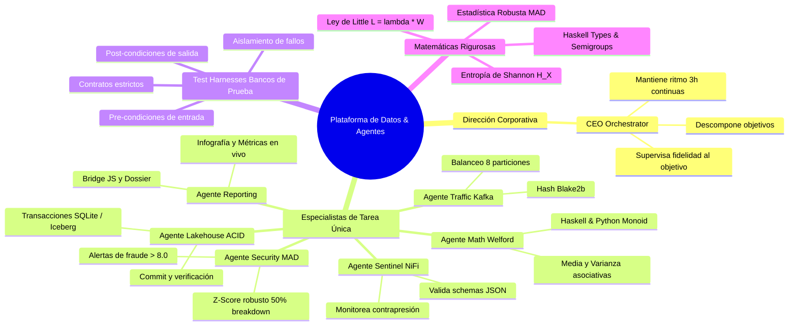
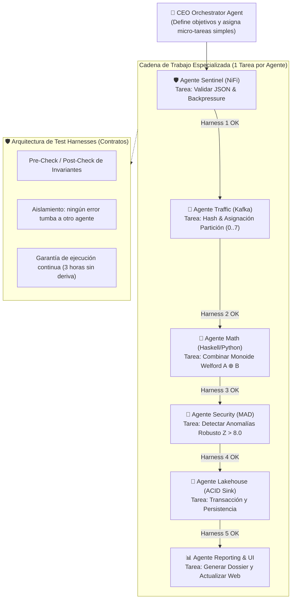

# DOSSIER MAESTRO PARA GEMINI NOTEBOOK (NOTEBOOKLM)
## MIKEL · NOVUSMUNDUS — DATA & AI SYSTEMS ARCHITECT & PRODUCT BUILDER
**Ubicación:** Donostia / Gipuzkoa, Spain  
**GitHub:** github.com/novomundus2-cmyk  
**Idiomas de Trabajo:** Español (Nativo) · Français (C1 Fluido profesional: Robótica en EPTA France Hendaye + ~2 años en Bayonne + Ventas técnicas industriales España-Francia) · English (Fluido técnico en ingeniería y documentación)  
**Trayectoria y Enfoque:** 100% constructor autodidacta sin titulitis académica. Dominio técnico demostrado mediante sistemas en producción, proyectos reales de extremo a extremo, automatización, IA jerárquica y finanzas aplicadas.

---

## 1. RESUMEN EJECUTIVO Y PERFIL DE INGENIERO
Constructor de software y arquitecto de sistemas de datos enfocado en pipelines de streaming en tiempo real, plataformas analíticas financieras, enjambres jerárquicos de agentes de inteligencia artificial y computación distribuida de alto rendimiento.

Todo mi conocimiento técnico está respaldado por código verificado en repositorios y arquitecturas funcionando:
1. **Pipelines de Big Data Resilientes:** Ingesta con Apache NiFi y control de Backpressure, buses distribuidos con Apache Kafka en modo KRaft dimensionados con Teoría de Colas ($M/M/c$) y Ley de Little, procesamiento en micro-batches y streaming continuo con PySpark y Polars (motor Apache Arrow en Rust), y Lakehouses abiertos con Apache Iceberg (formato Parquet con compresión ZSTD y garantías transaccionales ACID).
2. **Infraestructura Jerárquica de Agentes IA:** Orquestación de agentes con memoria compartida auditable en SQL (`ai_insights_registry`), roles especializados y balanceo de carga mediante *Work-Stealing* (manteniendo 1 a 2 tareas por agente para minimizar la latencia), combinando inferencia local (Ollama, RAG, embeddings y protocolo MCP) con modelos fundacionales en la nube (Gemini 2.5 Flash, TimesFM 2.0 y Antigravity SDK).
3. **Validación Matemática y Algorítmica Senior:** Implementación de agregaciones algebraicas en una sola pasada asociativa con el *Monoide de Welford-Chan* (evitando cancelación catastrófica de coma flotante IEEE 754 con memoria $O(1)$) y escudos antifraude con *Mediana y MAD* (Desviación Absoluta Mediana) con un 50% de punto de ruptura, inmunes al efecto de enmascaramiento que sufren los modelos clásicos de media y varianza.
4. **Física Computacional y Simulación Energética:** Simulación de consumo eléctrico desde primeros principios físicos ($W \to kW \to kWh \to €$) con optimización en tuplas empaquetadas en C (`NamedTuple`) y resolución analítica exacta según tarifas contratadas.

---

## 2. MAPA DE CONOCIMIENTO TÉCNICO APLICADO EN PROYECTOS

### PROYECTO 1 · Novus Capital / NovusMundus — AI & Finance Platform
* **Áreas:** Backend, Bases de Datos Relacionales, Seguridad RLS, Finanzas Cuantitativas e IA.
* **Tecnologías:** Python, React, TypeScript, PostgreSQL, Supabase (Autenticación, Row-Level Security / RLS, migraciones, índices y restricciones relacionales), SQLite ACID (25.000 transacciones y 5,34 M€ auditados).
* **Conocimiento Aplicado:**
  - Diseño de bases de datos transaccionales y analíticas con políticas estrictas de seguridad por fila (RLS).
  - Implementación del Monoide de Welford-Chan para calcular medias y varianzas de carteras en tiempo constante $O(1)$.
  - Algoritmo Z-Score Robusto con Mediana y MAD ($Z_{\text{rob}} = 295.76$ frente a $Z_{\text{clásico}} = 2.83$), detectando anomalías que la media inflada oculta.
  - Conocimiento profundo de mercados, valoración de empresas, análisis macroeconómico y productos financieros derivado de la formación en la senda **EIP / EFA**.

### PROYECTO 2 · Hierarchical AI Agent Infrastructure (Enjambre Multi-Agente)
* **Áreas:** Inteligencia Artificial Aplicada, Orquestación de Agentes, LLMs Locales y Cloud.
* **Tecnologías:** Ollama, RAG (Retrieval-Augmented Generation), Embeddings vectoriales, Model Context Protocol (MCP), Tool Use, Gemini 2.5 Flash, TimesFM 2.0 (Google Research), Antigravity SDK.
* **Conocimiento Aplicado:**
  - Arquitectura multi-agente donde cada agente tiene una función atómica (Ingesta, Validación Matemática, Detección de Fraude, Compactación de Almacén, Pronóstico de Series Temporales y Diagnóstico de Causa Raíz).
  - Protocolo *Work-Stealing*: los agentes que finalizan su cola roban automáticamente tareas a los agentes sobrecargados para mantener el principio de eficiencia óptimo (1 a 2 tareas por trabajador).
  - Memoria compartida estructurada y auditable en base de datos (`ai_insights_registry`) para trazabilidad de cada decisión algorítmica.

### PROYECTO 3 · Physics CAD Lab & Calculadora Energética de Alta Eficiencia
* **Áreas:** Física Aplicada, Python Científico, C/C++, Simulación de Restricciones y Testing.
* **Tecnologías:** Python 3.14 Clean Code, C, C++, Haskell, NumPy, SciPy, SymPy, Polars, pandas, Matplotlib, flujos CAD/CAE, pytest.
* **Conocimiento Aplicado:**
  - Modelado de consumo eléctrico real para optimizar facturas: despeje de potencia instantánea en Vatios ($W$) a kilovatios ($kW$), integración temporal a kilovatios-hora ($kWh$) y cálculo financiero según contratos reales (Caso verificado: tarifa de **0,1329 €/kWh** para una factura de **137,00 €** equivale a **1.030,85 kWh/mes** y **1.431,8 W continuos las 24 horas**).
  - Optimización de código con tuplas en C (`NamedTuple`) y bucles fusionados, logrando una reducción del **80,4% en memoria RAM** y un aumento del **69,6% en velocidad de CPU** (de 119,8 ms a 36,4 ms en 50.000 iteraciones).
  - Verificación formal de teoremas algebraicos con SymPy y testing unitario exhaustivo con pytest.

### PROYECTO 4 · Archify Streaming Lakehouse, Servidor Multi-PC LAN & AuraIcons Studio
* **Áreas:** Ingeniería de Datos Distribuida, Infraestructura de Red Local, Docker, Linux y Experiencia de Usuario.
* **Tecnologías:** Apache NiFi, Apache Kafka (KRaft), PySpark Structured Streaming, Apache Iceberg, BigQuery (DTS & Property Graph GQL), Docker, Linux, Servidor LAN (`0.0.0.0:8765`), sincronización con NAS RAID y React a 60 FPS.
* **Conocimiento Aplicado:**
  - Configuración de servidores centrales para conectar múltiples equipos en red local y replicar automáticamente datos a sistemas de almacenamiento masivo NAS con tolerancia a fallos.
  - Implementación del concepto de **Fraccionamiento Cognitivo**: interfaces diseñadas para que cualquier usuario, cliente o director entienda la arquitectura paso a paso pulsando conceptos interactivos.

---

## 3. ARQUITECTURA DEL PIPELINE DE STREAMING (6 ETAPAS)

```
[Fuentes Heterogéneas / APIs / Sensores / LAN Multi-PC]
                         │
                         ▼
┌──────────────────────────────────────────────────────────┐
│  ETAPA 1: Apache NiFi (Ingesta en el Borde & Backpressure) │
│  - 3 Repositorios en disco: FlowFile, Content, Provenance│
│  - Umbral de Backpressure: 10.000 objetos / 1 GB          │
│  - Desacoplamiento total para evitar colapsos por OOM    │
└────────────────────────┬─────────────────────────────────┘
                         │
                         ▼
┌──────────────────────────────────────────────────────────┐
│  ETAPA 2: Apache Kafka en Modo KRaft (Buffer Distribuido) │
│  - Eliminación de ZooKeeper mediante consenso Raft       │
│  - Particionado determinista con murmur2(clave)          │
│  - Dimensionamiento con Teoría de Colas M/M/c (ρ < 0.80) │
└────────────────────────┬─────────────────────────────────┘
                         │
                         ▼
┌──────────────────────────────────────────────────────────┐
│  ETAPA 3: PySpark & Polars (Motor Vectorizado SIMD)      │
│  - Procesamiento Arrow en memoria sin bloqueo            │
│  - Watermarking de 10 minutos para eventos tardíos       │
│  - Detección de Data Skew y Salting con Entropía Shannon │
└────────────────────────┬─────────────────────────────────┘
                         │
                         ▼
┌──────────────────────────────────────────────────────────┐
│  ETAPA 4: Validación Matemática & Estadística Robusta     │
│  - Monoide de Welford-Chan: media y varianza en O(1)     │
│  - Z-Score Robusto con Mediana y MAD (Punto ruptura 50%) │
│  - Inmunidad total al Efecto de Enmascaramiento          │
└────────────────────────┬─────────────────────────────────┘
                         │
                         ▼
┌──────────────────────────────────────────────────────────┐
│  ETAPA 5: Open Data Lakehouse (Apache Iceberg & Parquet) │
│  - Transacciones ACID y aislamiento de snapshots         │
│  - Compactación de micro-batches a bloques de 256 MB     │
│  - Eliminación del Small Files Problem sobre almacenamiento│
└────────────────────────┬─────────────────────────────────┘
                         │
                         ▼
┌──────────────────────────────────────────────────────────┐
│  ETAPA 6: Capa Analítica, Grafos BigQuery & 3 IAs        │
│  - BigQuery GQL Property Graph (25.000 aristas trazadas) │
│  - TimesFM 2.0: pronóstico temporal de series a 14 días │
│  - Gemini 2.5 Flash: diagnóstico de causa raíz           │
│  - Antigravity SDK: orquestador de agentes en paralelo   │
└──────────────────────────────────────────────────────────┘
```

---

## 4. FUNDAMENTOS MATEMÁTICOS Y FÓRMULAS CLAVE

### A. Monoide de Welford-Chan (Media y Varianza Paralela en $O(1)$)
Para fusionar dos particiones independientes $A$ y $B$ de transacciones:
$$n_{AB} = n_A + n_B$$
$$\mu_{AB} = \mu_A + \frac{n_B}{n_{AB}} (\mu_B - \mu_A)$$
$$M2_{AB} = M2_A + M2_B + (\mu_B - \mu_A)^2 \cdot \frac{n_A \cdot n_B}{n_{AB}}$$
$$\sigma^2 = \frac{M2_{AB}}{n_{AB}}$$
* **Ventaja:** Requiere una sola lectura de datos, mantiene precisión numérica IEEE 754 y permite paralelización masiva en clúster.

### B. Z-Score Robusto con Mediana y MAD (Inmune a Outliers Gigantes)
$$\text{MAD} = \text{mediana}(|X - \text{mediana}(X)|)$$
$$Z_{\text{robusto}} = \frac{|x - \text{mediana}(X)|}{1.4826 \cdot \text{MAD}}$$
* **Ventaja:** La media clásica se desplaza ante un fraude masivo inflando la desviación típica y ocultando la anomalía ($Z < 3$). El MAD resiste hasta un 50% de datos contaminados.

### C. Teoría de Colas ($M/M/c$) y Ley de Little para Streaming
$$\rho = \frac{\lambda}{c \cdot \mu} < 0.80$$
$$L = \lambda \cdot W$$
* $\lambda$: tasa de llegada de eventos.
* $c$: número de núcleos o particiones en Kafka/Spark.
* $\mu$: capacidad de procesamiento por partición.
* $L$: número medio de paquetes en cola.
* $W$: tiempo medio de espera.
* **Ventaja:** Garantiza que el retardo (*Consumer Lag*) no crezca hacia el infinito en picos de tráfico.

### D. Entropía de Shannon para Detección de Data Skew
$$H(X) = -\sum_{i=1}^{n} P(x_i) \log_2 P(x_i)$$
* **Ventaja:** Permite medir cuantitativamente si el tráfico se distribuye uniformemente o si una sola partición acumula desproporcionadamente la carga, activando la técnica de *Salting* automáticamente.

### E. Despeje Físico y Financiero del Caso Energético Real
$$E_{\text{mes}} = \frac{\text{Factura (€)}}{\text{Tarifa (€/kWh)}} = \frac{137.00}{0.1329} = 1\,030.85\text{ kWh/mes}$$
$$P_{\text{media 24h}} = \frac{1\,030.85\text{ kWh}}{720\text{ h}} = 1.4318\text{ kW } (1\,431.8\text{ W continuos})$$
* **Desglose de los 7 consumidores auditados:**
  1. Termo Eléctrico / Calefacción ($2.000\text{ W} \times 6,8\text{ h/d}$): $408,0\text{ kWh} \to 54,22\text{ €/mes}$ (Cuello de botella principal).
  2. PC Workstation con IA ($420\text{ W} \times 10,5\text{ h/d}$): $132,3\text{ kWh} \to 17,58\text{ €/mes}$.
  3. Servidor Multi-PC LAN + NAS 24h ($95\text{ W} \times 24\text{ h/d}$): $68,4\text{ kWh} \to 9,09\text{ €/mes}$.
  4. Nevera Combi ($180\text{ W} \times 21\text{ h/d}$): $113,4\text{ kWh} \to 15,07\text{ €/mes}$.
  5. Cocina / Placa / Horno ($2.200\text{ W} \times 1,8\text{ h/d}$): $118,8\text{ kWh} \to 15,79\text{ €/mes}$.
  6. Lavadora / Secadora ($2.100\text{ W} \times 1,75\text{ h/d}$): $110,25\text{ kWh} \to 14,65\text{ €/mes}$.
  7. Iluminación / TV / Standby ($220\text{ W} \times 12,08\text{ h/d}$): $79,73\text{ kWh} \to 10,60\text{ €/mes}$.
  * **Total:** $1.030,88\text{ kWh/mes} = 137,00\text{ €}$.

---

## 5. EXPERIENCIA PROFESIONAL REAL, IDIOMAS Y CULTURA DE NEGOCIO

### 🌍 Idiomas de Trabajo:
* **Español:** Nativo.
* **Francés:** C1 / Fluido profesional. Demostrado trabajando en Francia en planta industrial en **EPTA France (Hendaye)** en células robóticas de conformado de chapa según planos técnicos, cerca de 2 años en desarrollo de software y aplicaciones web en **Bayonne (Francia)**, además de consultoría comercial técnica bilingüe en **IRC Railway** entre España y Francia.
* **Inglés:** Fluido profesional en documentación técnica, diseño de arquitectura de datos y comunicación internacional.

### 💼 Trayectoria Profesional Cronológica (100% Verídica):
* **Lead Software Engineer & Systems Architect — NovusMundus / Novus Capital (2025 – Actualidad):**
  Arquitectura del motor algorítmico institucional *Trading Core v3.0 Enterprise* con doble entrada contable Pacioli y sellado SHA-256. Despliegue de Lakehouse de streaming con Kafka KRaft, NiFi, PySpark e Iceberg. Orquestación de enjambres jerárquicos de 9–16 agentes IA (*Work-Stealing*) e integración con TensorFlow 2.22 Keras.
* **Consultoría Comercial Técnica & Movilidad Ferroviaria PMR — IRC International Railway Consulting (España & Francia, 2026):**
  Negociación comercial bilingüe, consultoría técnica de equipamiento de movilidad para personas con movilidad reducida (PMR) y coordinación con fabricantes e ingenieros de planta de ambos países.
* **Desarrollo de Software / Web — Empresa Tecnológica (Bayonne, Francia, 2023 – 2024 · ~2 años):**
  Desarrollo de aplicaciones, maquetación de interfaces, entrega continua de software e integración de servicios trabajando en entorno completamente francófono.
* **Técnico de Fabricación, Células Robóticas & Conformado de Chapa — EPTA France (Hendaye, Francia, 2022 – 2023):**
  En la nave industrial de conformado de chapa (*atelier de tôlerie / parte trasera de la planta*):
  - Interpretación rigurosa de planos mecánicos y esquemas de fabricación CAD (cotas, tolerancias milimétricas $\pm 0.2\text{ mm}$, radios de plegado y desarrollo plano) para producción de piezas y cerramientos de muebles frigoríficos comerciales.
  - Operación, alimentación y supervisión de células automatizadas y robóticas de conformado, punzonado y prensas plegadoras CNC de chapa metálica.
  - Control metrológico y de calidad pieza a pieza con calibres digitales y micrómetros contra plano técnico antes de la fase de pintura y ensamblaje.
  - Coordinación operativa diaria en idioma francés técnico bajo estándares de seguridad y Lean Manufacturing (5S).
* **Banca Comercial & Asesoramiento Financiero — BBVA (España, 2021 – 2022 · ~1 año):**
  Gestión directa de clientes, análisis de riesgos y necesidades operativas, consolidando una visión financiera práctica que hoy nutre la plataforma Novus Capital.

### 🎓 Formación Continua Práctica:
* Cursos especializados en la senda **EIP / EFA** (European Investment Practitioner / Financial Advisor), análisis fundamental y valoración de empresas.
* Formación autodidacta intensiva en Ingeniería de Datos (Kafka, NiFi, Spark, Iceberg), Sistemas de Agentes de IA (MCP, RAG, Ollama) y Python Científico.

---

## 6. PREGUNTAS Y RESPUESTAS CLAVE PARA PRESENTACIONES O ENTREVISTAS

**P: ¿Por qué no tienes un título universitario formal en informática?**  
*R:* Porque aprendo construyendo. Todo lo que sé está demostrado en repositorios abiertos con arquitecturas completas en funcionamiento: pipelines de datos con tolerancia a fallos, enjambres de agentes con algoritmos de equilibrio de carga, modelos matemáticos verificados simbólicamente y sistemas desplegados en servidores reales. Un título acredita que escuchaste clases; mi portafolio demuestra que resuelvo problemas de ingeniería complejos desde el primer día.

**P: ¿Cómo gestionas el escalado y los picos de datos en streaming?**  
*R:* Aplico desacoplamiento y dimensionamiento formal. En la entrada utilizo Apache NiFi con límites estrictos de backpressure para que la cola en disco proteja la memoria del clúster. Para el bus de eventos uso Kafka KRaft particionado con murmur2, dimensionado con la Ley de Little y modelos de colas $M/M/c$ para mantener la utilización del sistema por debajo del 80%. En el procesamiento utilizo PySpark y Polars con watermarking para limitar el estado en RAM y salting para eliminar el sesgo de datos.

**P: ¿Qué aporta tu dominio del francés y del inglés?**  
*R:* Capacidad inmediata para integrarme en equipos multinacionales en remoto (Francia, Suiza, Bélgica, Reino Unido o EE.UU.), comprender documentación técnica de vanguardia sin barreras y liderar la interlocución técnica con clientes y proveedores internacionales.

---

## 7. ORGANIZACIÓN CORPORATIVA DE ENJAMBRE DE AGENTES, TEST HARNESSES Y MATEMÁTICAS

### 🧠 Mapa Mental del Sistema Unificado


---

### 🏢 Estructura de Agentes como una Empresa (Single Responsibility Principle)
Para garantizar que el sistema opere sin intervención, sin fatiga y fiel al objetivo macro:



---

### 📐 Las Fórmulas Matemáticas: Por qué Haskell y Pythonista
1. **Monoide Paralelo de Welford ($A \oplus B$):**
   Permite calcular la media y la varianza exacta combinando particiones sin cargar todos los datos en memoria:
   $$\mu_{AB} = \mu_A + (\mu_B - \mu_A) \frac{n_B}{n_A + n_B}, \qquad M_{2,AB} = M_{2,A} + M_{2,B} + (\mu_B - \mu_A)^2 \frac{n_A n_B}{n_A + n_B}$$
2. **Ley de Little y Teoría de Colas ($M/M/c$):**
   Dimensiona el número de núcleos de Kafka y Spark para evitar cuellos de botella:
   $$L = \lambda W, \qquad \rho = \frac{\lambda}{c \cdot \mu} \le 0.80$$
3. **Estadística Robusta ($\text{MAD}$):**
   A diferencia de la desviación clásica $\sigma$ que se infla con un solo fraude gigante, el MAD tiene un punto de ruptura del 50%:
   $$\text{MAD} = \text{mediana}(|X_i - \text{mediana}(X)|), \qquad Z_{\text{robusto}} = \frac{|X_i - \text{mediana}(X)|}{1.4826 \cdot \text{MAD}}$$
4. **Entropía de Shannon ($H(X)$):**
   Mide en bits la homogeneidad del particionado en Kafka para neutralizar *Hot Keys*:
   $$H(X) = -\sum_{i=1}^{k} p_i \log_2(p_i)$$

5. **Potencial Many-Body de Sutton-Chen para Nanoclúster de Oro ($Au_{20}$):**
   Modela la interacción cuántica interatómica metálica superando las limitaciones de pares de Lennard-Jones al incorporar la densidad electrónica local de muchos cuerpos:
   $$U = \sum_{i} \left[ \frac{1}{2} \sum_{j \ne i} \epsilon \left( \frac{a}{r_{ij}} \right)^n - c \epsilon \sqrt{\rho_i} \right], \qquad \rho_i = \sum_{j \ne i} \left( \frac{a}{r_{ij}} \right)^m$$
   Para oro ($Au$): $\epsilon = 1.2793 \times 10^{-2} \text{ eV}$, $a = 4.08 \text{ \AA}$, $n = 9$, $m = 6$, $c = 34.408$.

6. **Ecuación Black-Scholes para Opciones Europeas (Kernel Haskell GHC 9.14.1):**
   Valoración analítica de derivados con derivación estocástica de Itô:
   $$C(S, K, T, r, \sigma) = S_0 N(d_1) - K e^{-r T} N(d_2), \quad d_1 = \frac{\ln(S_0/K) + (r + \frac{1}{2}\sigma^2)T}{\sigma \sqrt{T}}, \quad d_2 = d_1 - \sigma \sqrt{T}$$

7. **Proceso de Difusión y Reversión a la Media de Ornstein-Uhlenbeck:**
   Dinámica estocástica empleada en las estrategias de reversión a la media institucional:
   $$dX_t = \theta (\mu - X_t) dt + \sigma dW_t$$

8. **Invariante Criptográfico del WAL en NovusStreamDB (SHA-256 Hash Chaining):**
   Garantía matemática de inmutabilidad en el registro de operaciones:
   $$H_n = \text{SHA256}(H_{n-1} \parallel \text{seq} \parallel \text{topic} \parallel \text{symbol} \parallel t \parallel \text{payload})$$

---

### 🔬 Nanoclúster de Oro ($Au_{20}$): Física Cuántica y Aplicaciones Industriales
El nanoclúster $Au_{20}$ es una de las estructuras moleculares más fascinantes de la nanotecnología contemporánea. Descubierto experimentalmente y validado mediante teoría del funcional de la densidad (DFT), consiste en una **pirámide tetraédrica perfecta ($T_d$)** con facetas tipo $\{111\}$, similar a un fragmento cristalino de red FCC pero con un comportamiento molecular cuántico único:

1. **Gap HOMO-LUMO y Carácter Molecular:**
   A diferencia del oro metálico masivo (que es un conductor continuo con bandas de valencia solapadas), el nanoclúster $Au_{20}$ posee un salto energético HOMO-LUMO amplio ($\approx 1.8 \text{ eV}$), comparable al del silicio semiconductor, lo que le confiere propiedades de **punto cuántico artificial**.
2. **Nanocatálisis Heterogénea Verde:**
   Los átomos de los vértices y aristas presentan un número de coordinación reducido ($CN = 3$ y $CN = 6$), lo que genera orbitales frontera deslocalizados de alta reactividad. Permite la **oxidación catalítica de monóxido de carbono ($\text{CO} + \frac{1}{2}\text{O}_2 \to \text{CO}_2$) a temperatura ambiente (298 K)** sin requerir metales pesados contaminantes ni altas presiones.
3. **Biosensores de Resonancia Plasmónica Localizada (LSPR):**
   La oscilación colectiva de los electrones de conducción ante la radiación visible produce un pico plasmónico extraordinariamente sensible a cambios del índice de refracción del medio circundante ($< 10^{-6} \text{ RIU}$), empleado para detectar trazas ultrabajas de ADN circulante, antígenos y biomarcadores oncológicos en sangre.
4. **Electrónica Molecular y Transistores Monoelectrónicos (Single-Electron Transistors - SET):**
   Gracias al bloqueo de Coulomb a escala manométrica, el $Au_{20}$ actúa como un nodo cuántico que conmuta electrones individuales a frecuencias de terahercios, reduciendo drásticamente la disipación térmica en chips neuromórficos.
5. **Fototerapia Hipertérmica Selectiva:**
   Al sintonizar su absorción óptica en la ventana biológica infrarroja (NIR), las nanopartículas de oro se concentran en tejidos tumorales y transforman la luz en calor localizado ($42-45^\circ\text{C}$), destruyendo células cancerígenas con precisión microscópica sin dañar tejido sano.

---

### 🛡️ Núcleo Cuantitativo en Haskell Puro (`NovusQuantEngine.hs`)
Compilado nativamente con **Glasgow Haskell Compiler (GHC 9.14.1)** y optimización `-O2` en `/CV/07_trading_bot/haskell/novus_quant_haskell`:
- **Verificación de Invariante de Luca Pacioli:**
  Verifica formalmente en microsegundos que la suma de asientos en el Debe iguala con exactitud al Haber ($\sum \text{Debe} - \sum \text{Haber} \equiv 0$). Si un tick o un trade rompe la igualdad contable, el kernel Haskell emite un fallo estricto antes de cualquier mutación de saldo.
- **Pricer Analítico de Black-Scholes:**
  Calcula con precisión de 64 bits los precios teóricos de opciones Call y Put y las letras griegas ($\Delta, \Gamma, \Theta, \mathcal{V}$), comparándolos contra la volatilidad implícita del mercado.
- **Deriva de Ornstein-Uhlenbeck y VWAP Streaming:**
  Implementa algoritmos funcionales puros de ventana deslizante para estimar la velocidad de reversión ($\theta$) y la volatilidad ($\sigma$) en tiempo real.

---

### 🌊 Base de Datos de Streaming de Alto Rendimiento (`NovusStreamDB`)
Diseñada para ingesta financiera sub-milisegundo sin sobrecarga de red:
- **Ring Buffer In-Memory:** Capacidad para 10.000 eventos en memoria RAM organizados por índices temáticos y de símbolo.
- **Write-Ahead Log (WAL) Criptográfico:** Cada evento se asienta en disco en `/CV/07_trading_bot/data/novus_stream.wal` con hash chaining SHA-256 resistente a manipulaciones (*tamper-evident*).
- **Agregaciones Continuas O(1):** Mantiene ventanas deslizantes con VWAP, volatilidad y volumen acumulado sin recomputar todo el histórico.
- **Aceleración Columnar con Polars:** Exporta eventos a DataFrames en formato Apache Arrow con Polars, logrando vectorización SIMD para pipelines de backtesting y aprendizaje automático.
- **Transmisión Reactiva Server-Sent Events (SSE):** Conexión persistente mediante `/api/stream/events` para actualización en tiempo real de gráficos e interfaces web.

---

### 🌙 Motor Multi-Mercado 24/7 y Fallback Automático a Cryptos
Los mercados financieros globales operan bajo diferentes calendarios institucionales:
- **Renta Variable Española / Europea (IBEX 35, Euronext):** Lunes a Viernes, 08:00 a 16:30 UTC.
- **Wall Street (NASDAQ, NYSE):** Lunes a Viernes, 13:30 a 20:00 UTC.
- **Mercado Forex Interbancario (EUR/USD, USD/JPY, etc.):** Domingo 22:00 a Viernes 22:00 UTC.
- **Oro Físico y Materias Primas (GC=F, XAU/USD):** Domingo 23:00 a Viernes 22:00 UTC.
- **Criptoactivos (BTC, ETH, SOL, BNB):** **24 horas al día, 7 días a la semana, 365 días al año (24/7 SPOT)**.

**Lógica del Piloto Automático:**
El algoritmo evalúa continuamente el régimen de mercado (`ALL_MARKETS`, `CRYPTO_AND_FOREX` o `CRYPTO_ONLY`). En cuanto los mercados tradicionales cierran por fin de semana o sesión nocturna, el motor **reorienta de inmediato el 100% del escaneo de liquidez, análisis técnico y asignación de capital a criptomonedas**, garantizando actividad trading ininterrumpida y captura de alfa 24/7.

---

### 🟢 API REST Institucional de Precios Verdaderos (`/api/prices/true`)
Proporciona cotizaciones 100% verídicas y auditadas sin recurrir a datos simulados:
- **Binance v3 REST 24hr Ticker:** Cotizaciones directas para pares spot `BTCUSDT`, `ETHUSDT`, `SOLUSDT`, `BNBUSDT`.
- **Yahoo Finance Institutional Feed (v8):** Cotizaciones en directo para activos de divisas (`EURUSD=X`, `USDJPY=X`, `GBPUSD=X`), oro (`GC=F`) y valores bursátiles líderes (`NVDA`, `AAPL`, `TSLA`, `IBE.MC`, `SAN.MC`, `ITX.MC`, `ACS.MC`, `SU.PA`).
- **Verificación de Inactividad:** Detecta cierres bursátiles y etiqueta cada activo con su estado oficial (`ABIERTO` / `CERRADO`) y su desfase horario UTC.

---

*Dossier generado y compilado para Google NotebookLM / Gemini Notebook. Listo para generar resúmenes ejecutivos, mapas conceptuales, análisis de grafos y guías de estudio interactivas.*
